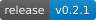

<h1 align="center">shadow-ink</h1>

<p align="center">通过终端输出传输文件，随时中断，继续接收。</p>

<p align="center">
  <a href="https://github.com/Chivier/shadow-ink/actions/workflows/check.yml"></a>
  <a href="https://github.com/Chivier/shadow-ink/releases/latest"></a>
  <a href="LICENSE"></a>
</p>

<p align="center">
  <a href="https://chivier.github.io/shadow-ink/">文档</a> ·
  <a href="#安装">安装</a> ·
  <a href="#使用">使用</a> ·
  <a href="README.md">English</a>
</p>

shadow-ink 通过 Base64 字符或二维码播放，把远端文件传回本机。一条命令处理 SSH、tmux、断点和 SHA-256 校验。

```sh
shadow-ink server-a /path/to/results.bin
```

## 演示

**QR · V12-M**

https://github.com/user-attachments/assets/65f0520c-da18-43f1-9ba9-5782b4842690

**Base64 · pipe**

https://github.com/user-attachments/assets/bbfda50e-38a6-4ee9-8366-99c880bc5c2e

<sub>使用真实协议帧；播放节奏和图像还原为演示编排，不代表性能实测。[录制源码](demo/README.md)。</sub>

## 特点

- **一条命令。** 准备远端快照，自动创建本地 tmux 会话。
- **断点续传。** 复核已保存的分片，补传缺失或损坏的分组。
- **完整校验。** CRC32C、Reed–Solomon 恢复和完整文件 SHA-256。
- **三种通道。** Base64 字符流、逐屏字符采样和 QR，使用相同帧协议。
- **文件与目录。** 支持目录归档和同名文件保护，适用于 macOS 与 Linux。

## 安装

为两端下载对应的[最新发行包](https://github.com/Chivier/shadow-ink/releases/latest)：

| 安装位置 | 发行包 |
| --- | --- |
| macOS | `shadow-ink-*-macos-universal2.tar.gz`，兼容 Apple Silicon 与 Intel |
| Linux 接收端 | `shadow-ink-*-linux-x86_64.tar.gz` |
| Linux 发送端 | `shadow-ink-send-*-linux-{x86_64,aarch64}.tar.gz`，静态版本 |

核对包内的 `SHA256SUMS`，解压后将程序安装为 `shadow-ink`：

```sh
mkdir -p ~/.local/bin
install -m 755 ./shadow-ink ~/.local/bin/shadow-ink
# 确保 ~/.local/bin 位于 PATH 中。
shadow-ink --version
```

两端均需 `shadow-ink` 和 Python 3.9+。接收端另需 tmux、SSH；远端主机需能通过 SSH 免交互登录。

[源码构建](docs/BUILD.md) · [macOS 设置](docs/MACOS.md)

## 使用

使用现有 SSH 配置中的主机名或别名：

```sh
# 默认通过 Base64 字符流下载文件。
shadow-ink server-a /home/user/results.bin

# 下载目录，并指定本机保存位置。
shadow-ink server-a '/home/user/实验数据' -o ./received

# 继续上次快照，或准备一个新快照。
shadow-ink server-a /path/file --resume
shadow-ink server-a /path/file --fresh

# 使用二维码播放或逐屏字符采样。
shadow-ink server-a /path/file --backend qr --speed safe
shadow-ink server-a /path/file --backend text
```

默认保存到 `~/Downloads/from-server-a/`。目录以 `.tar` 归档保存。中断后重跑原命令即可续传；已有同名、不同内容的文件会保留。

`--resume` 恢复原快照，即使源文件已变化；`--fresh` 才获取当前内容。续传需要保留本机断点与远端快照。一键入口默认大小上限为 8 GiB。

[全部参数与示例 →](https://chivier.github.io/shadow-ink/#parameters)

## 文档

- [快速开始](https://chivier.github.io/shadow-ink/#quick-start)
- [后端选择](https://chivier.github.io/shadow-ink/#transports)
- [续传与快照](https://chivier.github.io/shadow-ink/#resume)
- [参数速查](https://chivier.github.io/shadow-ink/#parameters)
- [手动接收与录像输入](docs/MANUAL.md)
- [协议](docs/PROTOCOL.md) · [性能测量](docs/PERFORMANCE.md)

文档站的源文件维护在 [`docs/`](docs/README.md)。

## 参与开发

欢迎提交问题和 Pull Request。环境准备与验证方式见 [CONTRIBUTING.md](CONTRIBUTING.md)。报告问题时请附版本、系统、后端和可复现的小示例。

## 许可证

[MIT](LICENSE)。演示字体保留各自许可证；视频中的参考照片不属于代码的 MIT 授权范围。
